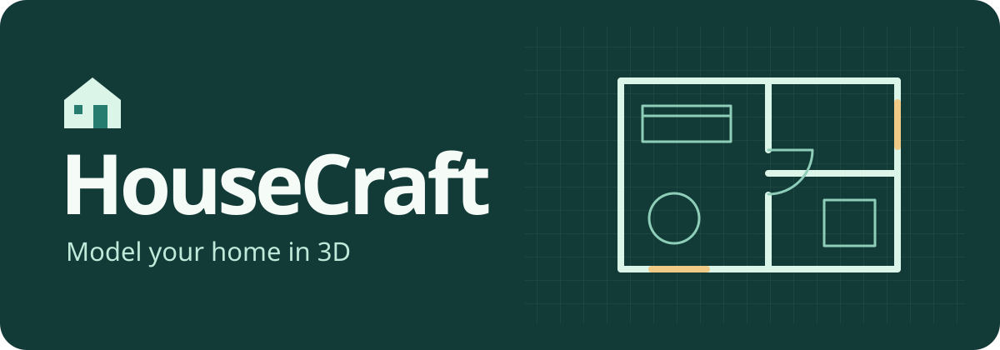

# HouseCraft

Give your coding agent floor plans, photos or measurements to create an editable model of a single-level home. Preview the existing layout and proposed changes in your browser. HouseCraft runs on your computer without a HouseCraft account.

## Get started

Use a coding agent that can run commands and access your files on your computer. You’ll need Git, Node.js 22 or later, npm and a browser with WebGL support. The agent sets up the separate [HouseCraft Viewer](https://github.com/pankajvaghela/housecraft-viewer); Blender and AgentCAD are optional authoring tools.

- **Claude Code:** Run `claude plugin marketplace add pankajvaghela/housecraft-plugin` and then `claude plugin install housecraft@housecraft`. In a new session, use `/housecraft:setup` and `/housecraft:create-house`.
- **Codex desktop:** Run `codex plugin marketplace add pankajvaghela/housecraft-plugin`, then install **HouseCraft** from the **HouseCraft** marketplace in the Plugins Directory. Reopen the desktop app if the source does not appear. Start setup from the plugin or ask Codex to use the setup skill.
- **Cursor or another coding agent:** Share the [setup](skills/setup/SKILL.md) and [create-house](skills/create-house/SKILL.md) instructions with your agent. For Cursor skill discovery, copy both skill folders together into your project's `.cursor/skills/` directory.

1. **Set up the viewer.** Ask “Set up HouseCraft and check whether my computer can run the local preview.”
2. **Model your home.** Give the agent your plans or measurements. Try “Model my current layout and add a version with the dining table by the window. Mark any dimensions you estimate.”
3. **Compare in 3D.** Open the localhost URL from your agent and use **House version** to switch between the existing layout and your renovation variant. The agent can edit your `housecraft.json` project as your ideas change.

The viewer shows rooms, walls, doors, windows and dimensioned furniture boxes. It does not load GLB models or assess structural feasibility. Your agent handles any inputs you share according to that agent’s settings.

[Report an issue](https://github.com/pankajvaghela/housecraft-plugin/issues) · [Release notes](CHANGELOG.md) · [MIT license](LICENSE)
